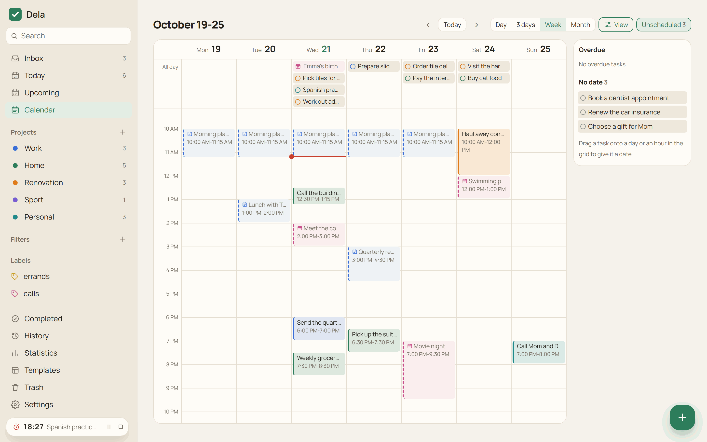
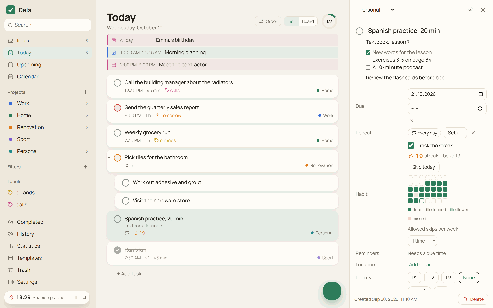
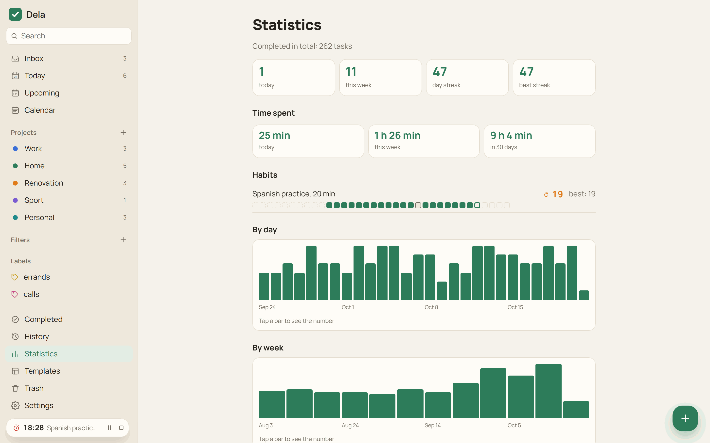
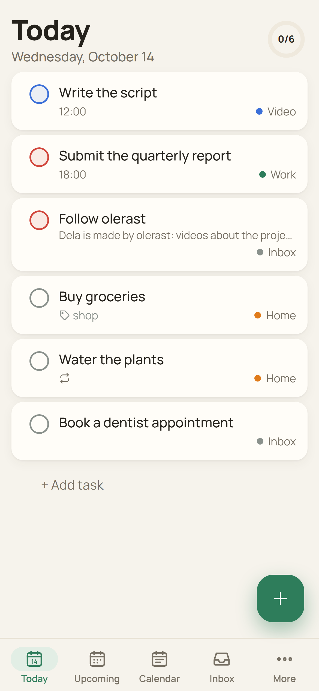
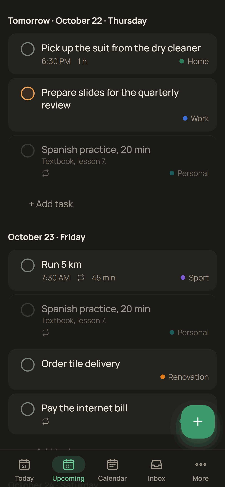

<p align="center">
  
</p>

<h1 align="center">Dela</h1>

<p align="center"><b>English</b> · <a href="README.ru.md">Русский</a> · <a href="https://olerast67.github.io/dela/">Website</a> · <a href="https://olerast67.github.io/dela/demo/">Demo without a server</a></p>

<p align="center">
  <a href="https://github.com/olerast67/dela/releases/latest"></a>
  <a href="https://github.com/olerast67/dela/releases"></a>
  <a href="https://github.com/olerast67/dela/actions/workflows/ci.yml"></a>
  <a href="LICENSE"></a>
  <a href="docs/architecture.md"></a>
  
</p>

<p align="center">
  <a href="https://github.com/olerast67/dela/releases/latest"></a>
  &nbsp;
  <a href="https://github.com/olerast67/dela/releases/latest"></a>
  &nbsp;
  <a href="https://apps.obtainium.imranr.dev/redirect?r=obtainium://add/https://github.com/olerast67/dela"></a>
  &nbsp;
  <a href="#run-your-own-server"></a>
</p>

Dela (Russian *дела*, "things to do") is an open-source task manager with end-to-end encryption for the web, Windows, Android and Wear OS watches. Tasks are encrypted on your devices, and the server stores and syncs only ciphertext. You run the server yourself with one Docker command, or try Dela without a server, with the tasks kept in the browser.

Every device keeps a full copy of the tasks, so the apps open without waiting for the network and work offline. The Dela Verify browser extension checks the web app your server delivers against the signed release, and release files come with a build provenance attestation from GitHub Actions. All features are free.

<p align="center">
  
</p>

## Contents

- [Features](#features)
- [Install the apps](#install-the-apps)
- [Run your own server](#run-your-own-server)
- [AI assistants (dela-mcp)](#ai-assistants-dela-mcp)
- [Security and privacy](#security-and-privacy)
- [Build from source](#build-from-source)
- [Support and license](#support-and-license)

## Features

### Tasks and quick add

- Quick add reads English and Russian phrases while you type: "call mom tomorrow at 7pm #Home every week p1", "buy paint tomorrow at 10am remind me an hour before". Recognized parts are highlighted, and one click keeps a word as plain text.
- A pasted list becomes one task per line. Indented lines become subtasks, checked `[x]` items are skipped, and the list can be edited as text before adding.
- Projects with sub-projects, sections, subtasks, labels, priorities 1-4, due date with time and time zone, start date, deadline and duration. Projects and sections have Markdown descriptions.
- Repeats by schedule or from the completion date ("every 2nd tuesday of the month", "every 3 days after completion"), typed as a phrase or set with buttons.
- Task descriptions and comments use Markdown: headings, lists, links, tables and checklists. A checklist item in the description is checked with a click.
- Filters in Todoist syntax (`(today | overdue) & p1`, `#Work & !@waiting`), grouping and sorting by date, priority, project or label, Today as a board by priority.
- Select several tasks with Ctrl+click or a long press and complete, reschedule, move or label them at once. One Undo reverts the whole action.
- Ctrl+Shift+C copies a link to the current screen or task. The link opens in a browser and in the Android and Windows apps.

<p align="center">
  
</p>

### Today, calendar and events

- Today lists the day's calendar events above the tasks, subtasks under their parents, and a repeating task checked off today as a crossed-out row until the end of the day.
- The calendar shows a day, 3 days, a week or a month. Tasks are dragged between days, into the hour grid, and from the "Unscheduled" panel with overdue and undated tasks. On a phone, hold a task and drag it with a finger.
- Calendar events from an iCal link (for example the secret address of a Google calendar) appear in Today and in the calendar, read-only. On Android, events from the phone calendars can be shown as well; they stay on the phone.

<p align="center">
  
</p>

### Habits, Pomodoro and statistics

- A repeating task can be a habit. The row shows the current streak, and the card shows the best streak, the last five weeks and a "Skip today" button. Up to 6 skips a week can be allowed without breaking the streak.
- The Pomodoro timer in the task card runs 25 minutes of work and a 5-minute break by default. Time worked adds up in the task as "Time spent".
- Statistics counts completed tasks per day and per week, day streaks, time spent and completions per project. It is calculated on the device.

<p align="center">
  
  
</p>

### Reminders and the phone

- Reminders arrive in the open app, through Web Push in the browser, from the Android alarm schedule without a network, and through UnifiedPush (ntfy) without Google services.
- An urgent task on Android rings as a full-screen alarm over the lock screen, in silent mode and with Do Not Disturb on.
- Location reminders on Android fire on arrival at a place or on leaving it. The phone watches the zones with `LocationManager`, without Google Play services, and the coordinates reach the server only inside the encrypted task.
- Share a picture or a voice message to Dela on Android, and the text is recognized on the phone (Tesseract for text, sherpa-onnx for speech) and opens in quick add. The models are downloaded on request.
- Voice input without the cloud on Android and Windows: the microphone button in quick add recognizes the phrase on the device with the same sherpa-onnx models, and the audio is not sent anywhere.
- A morning summary at the chosen time: "Today: 5 tasks, 2 overdue".
- The Android home screen widget shows Today, the week or a project, and a quick settings tile opens quick add.

### Windows, watch and AI assistants

- The Windows app lives in the tray, opens quick add with `Ctrl+Shift+Space`, can start when you sign in to Windows, opens a project or a task in its own window and updates itself from signed releases.
- The Wear OS app shows Today, checks tasks off and shows reminders. It signs in to your server by itself and needs neither the phone nor Google services.
- [dela-mcp](#ai-assistants-dela-mcp) gives Claude Desktop and other MCP clients tools to find, add, change and complete tasks. It runs on your computer and keeps the keys there.

### Sharing, files and your data

- Shared projects with members invited by email, assignees and comments. Comments are signed by their authors.
- Files up to 100 MB (the server default) are attached to comments. Each file is encrypted on the device and uploaded in 4 MiB parts; an interrupted upload continues from the missing parts.
- Import from Todoist by API token or export file, export to JSON and Markdown, project templates, history of actions.
- English and Russian interface, following the system language or chosen in Settings.

<p align="center">
  
  
</p>

## Install the apps

All files are on the [releases page](https://github.com/olerast67/dela/releases/latest). The apps ask for your server address at the first sign-in.

| Platform | File | Notes |
|---|---|---|
| Android 7 and newer | `Dela-<version>-android.apk` | Updates through [Obtainium](https://apps.obtainium.imranr.dev/redirect?r=obtainium://add/https://github.com/olerast67/dela). Dela is not in F-Droid or Google Play yet |
| Windows 10 and 11 | `Dela_<version>_x64-setup.exe` | Installs for the current user. The installer is not code-signed yet, so Windows SmartScreen asks for confirmation. Later versions install themselves from the app |
| Wear OS 3 and newer | `Dela-<version>-wear.apk` | Install with ADB over Wi-Fi from the watch developer options: `adb install Dela-<version>-wear.apk`. Sign in on the watch with your email and password |
| Any browser | your server address | Installs as a PWA on a computer and on Android. On an iPhone, Safari can add it to the home screen, and Web Push works from iOS 16.4 |

The [demo](https://olerast67.github.io/dela/demo/) runs without a server and keeps the tasks only in your browser.

Every APK and installer is built by the [release workflow](.github/workflows/release.yml) from the tagged source. To check a downloaded file:

```bash
gh attestation verify Dela-<version>-android.apk --repo olerast67/dela
```

## Run your own server

You need a server with Docker and a domain name whose DNS record points to it. Service workers and Web Push require HTTPS, and the bundled Caddy obtains the certificate itself.

```bash
mkdir dela && cd dela
curl -fsSLO https://raw.githubusercontent.com/olerast67/dela/main/docker-compose.yml
curl -fsSL https://raw.githubusercontent.com/olerast67/dela/main/.env.example -o .env
nano .env    # your email and domain
docker compose --profile https up -d
```

Then open `https://<your domain>` and register with the email from `DELA_ADMIN_EMAIL`. This first account becomes the administrator. Other people register with an invite link from Settings → Invites, unless `DELA_OPEN_REGISTRATION` is on.

If you already have a reverse proxy, start without the profile: `docker compose up -d`. Dela then listens on `127.0.0.1:8080`, and a Caddy site for it looks like this:

```
tasks.example.com {
	reverse_proxy 127.0.0.1:8080
}
```

The image `ghcr.io/olerast67/dela` is built for amd64 and arm64. The `latest` tag is the latest release, `edge` follows the main branch, and a fixed version is available by its number (`ghcr.io/olerast67/dela:<version>`).

### Server settings

Settings are environment variables. With the bundled `docker-compose.yml`, put them in `.env`; the compose file passes `DELA_ADMIN_EMAIL`, `DELA_OPEN_REGISTRATION`, `DELA_PUBLIC_URL`, `DELA_BACKUP_KEEP`, `DELA_MAX_FILE_MB`, `DELA_MAX_FILE_MB_PER_SPACE`, `DELA_CALENDAR_HOSTS` and `DELA_PUSH_HOSTS` to the server, and others can be added to its `environment` section.

| Variable | Default | What it does |
|---|---|---|
| `DELA_ADMIN_EMAIL` | empty | The only address that can register first. This account becomes the administrator |
| `DELA_DOMAIN` | empty | Domain for the bundled Caddy (`--profile https`). Used by `docker-compose.yml` only |
| `DELA_PUBLIC_URL` | empty | Address the web app is opened at, for example `https://tasks.example.com`. Needed for passkeys |
| `DELA_OPEN_REGISTRATION` | `false` | `true` lets anyone register without an invite |
| `DELA_MAX_FILE_MB` | `100` | Largest file attached to a comment, MB |
| `DELA_MAX_FILE_MB_PER_SPACE` | `1024` | All encrypted files of one project space, MB |
| `DELA_MAX_FILE_MB_PER_USER` | `2048` | All files one user has uploaded to all spaces, MB |
| `DELA_CALENDAR_HOSTS` | empty | Calendar hosts the web app may load iCal subscriptions from, comma-separated, for example `calendar.example.com`. The Android and Windows apps load any calendar without it |
| `DELA_PUSH_HOSTS` | empty | Your own UnifiedPush distributors, host names comma-separated. ntfy.sh is allowed by default |
| `DELA_BACKUP_KEEP` | `7` | Daily database snapshots kept in `<data>/backups`. `0` turns them off |
| `DELA_SESSION_TTL_DAYS` | `180` | Lifetime of a device session, days |
| `DELA_MAX_RECORDS_PER_SPACE` | `500000` | Stored fields per project space |
| `DELA_MAX_SYNC_MB_PER_SPACE` | `256` | Encrypted task data of one project space, MB. Files are counted separately |
| `DELA_SYNC_RATE_LIMIT` | `1200` | Sync uploads one user may send in 15 minutes. Over the limit the app keeps changes and sends them later |
| `DELA_MAX_SHARED_SPACES` | `200` | Shared projects one user can create |
| `DELA_TRUST_PROXY` | `false` (`true` in `docker-compose.yml`) | Take the client address from `X-Forwarded-For` for login rate limits. Turn it on only behind a reverse proxy, because the header can be forged |
| `DELA_VAPID_SUBJECT` | `https://github.com/olerast67/dela` | Contact for push services, `mailto:` or `https:` |
| `DELA_PORT` | `8080` | Port the server listens on. `PORT` works too |
| `DELA_HOST` | `0.0.0.0` | Address the server listens on |
| `DELA_DATA_DIR` | `./data`, `/data` in the image | Folder for the database and backups |
| `DELA_DB_PATH` | `<data>/dela.sqlite` | Database file |
| `DELA_WEB_DIR` | the built web app | Folder of the web app the server delivers. Empty means the server answers the API only |
| `DELA_CORS_ORIGINS` | empty | Origins allowed to call the API, comma-separated. Empty allows any origin, and the Windows and Android apps call the API from their own origins |
| `DELA_MAX_CLOCK_DRIFT_MS` | `60000` | How far ahead of the server clock a change may be stamped, ms |

### Updating and backups

```bash
docker compose pull && docker compose --profile https up -d
```

Migrations run at startup, and before them the server copies the database to `/data/dela.sqlite.before-vN-<time>.bak`. Once a day it writes a snapshot to `/data/backups`. A plaintext export is in the app under Settings → Export.

## AI assistants (dela-mcp)

`dela-mcp` is an MCP server that runs on your computer and connects Claude Desktop and other MCP clients to your tasks. It signs in to your Dela server as a new device of your account, keeps the keys on the computer and decrypts tasks locally. It is not published to npm: every release has the ready archive `dela-mcp.tgz`, and `npx` runs it from the link below. It needs Node.js 22.18 or newer.

```sh
npx -y https://github.com/olerast67/dela/releases/latest/download/dela-mcp.tgz login   # server address, email, password and the 2FA code if it is on
```

In Claude Desktop open Settings → Developer → Edit Config, add the server to `claude_desktop_config.json` and restart Claude Desktop:

```json
{
  "mcpServers": {
    "dela": { "command": "npx", "args": ["-y", "https://github.com/olerast67/dela/releases/latest/download/dela-mcp.tgz"] }
  }
}
```

The tools are `search_tasks`, `list_projects`, `add_task` (a quick-add phrase in English or Russian), `update_task`, `complete_task` and `today`. There are no delete tools. The computer appears in Settings → Devices and can be revoked there or with `npx -y https://github.com/olerast67/dela/releases/latest/download/dela-mcp.tgz logout`. The assistant sees the decrypted tasks it asks for. Storage of the session and keys is described in [packages/mcp/README.md](packages/mcp/README.md).

## Security and privacy

Argon2id derives two keys from the password on the device: one proves the login to the server, the other unlocks the account master key. Every change is encrypted with XChaCha20-Poly1305 using the key of its space (libsodium). A passkey with the PRF extension can replace the password. Shared projects get their key sealed for each member, and a new key after a member is removed.

The server sees email addresses, devices, members of shared projects, change times, sizes rounded to 64 bytes and reminder times. Task text, dates, labels, project names, field names and record IDs reach it only encrypted. If both the password and the recovery key are lost, the data cannot be decrypted. Statistics, habits and the morning summary are calculated on the device.

In a browser, the code of the web app comes from your server, and a server taken over by someone else could change it. The Windows and Android apps carry their own code. For browsers there is the Dela Verify extension (`extension/`, `Dela-Verify-<version>.zip` in each release): it compares the files the page loaded with `web-manifest.json`, which lists SHA-256 hashes of the web app and is signed with the project key `y3Zkairxm+9yU65AqArxf1PUT63ygFlnRAs676WEZGs=` (Ed25519). The check works with the official image.

Known limitations, the threat model and the protocol are in [docs/architecture.md](docs/architecture.md). What the server stores is listed in [PRIVACY.md](PRIVACY.md), and vulnerabilities are reported as described in [SECURITY.md](SECURITY.md).

## Build from source

Node.js 22.18 or newer is required.

```bash
npm install
npm run check          # type check and unit tests
npm run test:e2e       # Playwright scenarios in Chromium
npm run build:web && npm start   # server with the web app on http://localhost:8080
npm run screenshots    # screenshots in docs/images from the web app without a server
```

| Folder | Contents |
|---|---|
| `packages/core` | Shared core: sync, encryption, task model, quick add parser, repeats, filters |
| `packages/mcp` | dela-mcp, the MCP server for AI assistants |
| `apps/server` | Server on Node.js, Hono and the built-in SQLite |
| `apps/web` | Web app on React and Vite |
| `apps/desktop` | Windows app on Tauri 2 |
| `apps/mobile` | Android app on Capacitor |
| `apps/wear` | Wear OS app; the core runs in QuickJS |
| `extension` | Dela Verify for Chrome, Edge and Firefox |

Read [CONTRIBUTING.md](CONTRIBUTING.md) before opening a pull request. The release process is in [RELEASING.md](RELEASING.md), and what comes next is in the [roadmap](ROADMAP.md): F-Droid, templates for Coolify, CasaOS, Unraid and YunoHost, and a code-signed Windows installer.

## Support and license

Found a bug? [Report a bug](https://olerast.com/security) on olerast.com (no GitHub account needed, vulnerabilities too) or open an issue in [GitHub Issues](https://github.com/olerast67/dela/issues). The same links are in the app under Settings → Help.

Dela is free and has no paid features. Donations pay for the time spent on new platforms and for an external security audit: a [one-off donation on Boosty](https://boosty.to/olerast/donate), [monthly support on Boosty](https://boosty.to/olerast), or USDT on TRON from [DONATE.md](DONATE.md).

I make videos about the projects I build and test on myself: [YouTube](https://www.youtube.com/@olerast), [Telegram](https://t.me/olerast), [olerast.com](https://olerast.com). The code is written by Claude from Anthropic on my instructions and is covered by unit and end-to-end tests that run in GitHub Actions on every commit.

Dela is licensed under [AGPL-3.0](LICENSE).
