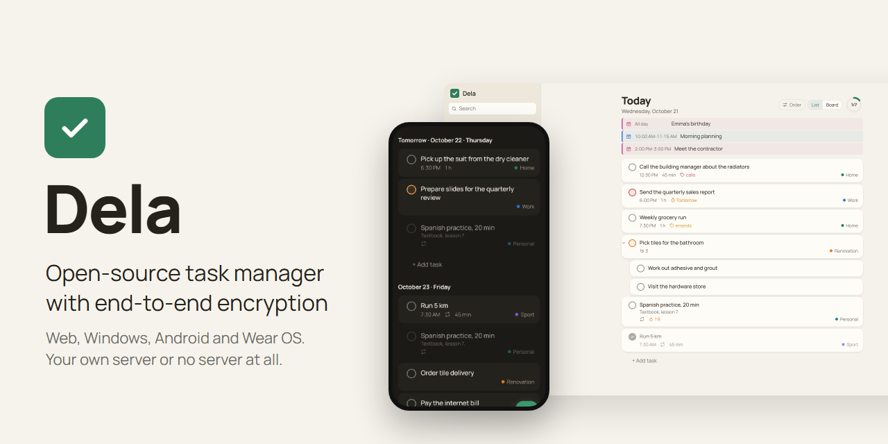
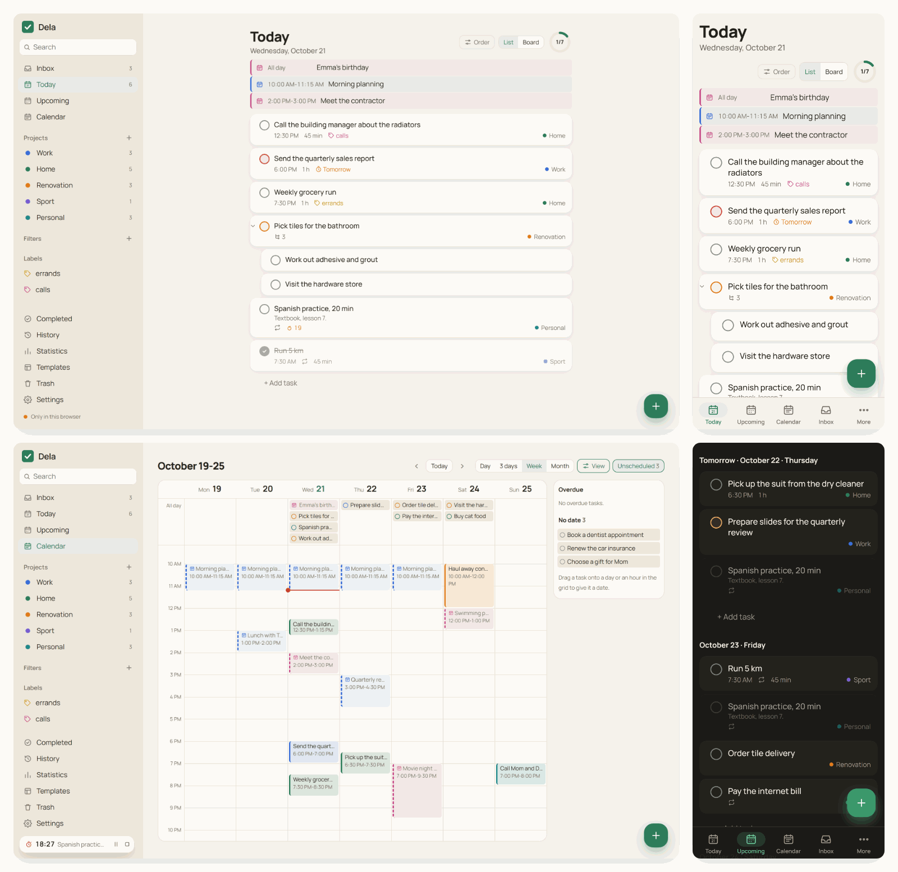
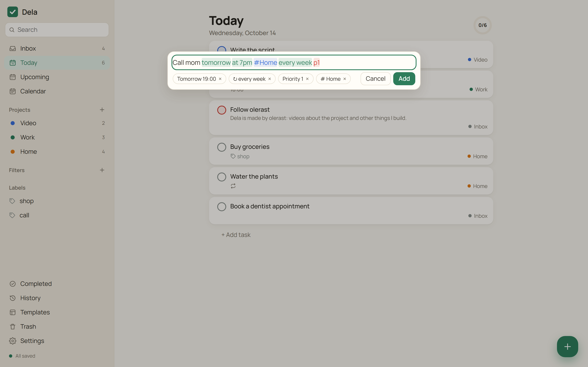

<p align="center">
  
</p>

<h1 align="center">Dela: task manager with end-to-end encryption</h1>

<p align="center">
  <a href="https://github.com/olerast67/dela/releases/latest"></a>
  <a href="https://github.com/olerast67/dela/releases"></a>
  <a href="https://github.com/olerast67/dela/actions/workflows/ci.yml"></a>
  <a href="LICENSE"></a>
  <a href="docs/architecture.md"></a>
  
</p>

<p align="center">
  <a href="https://github.com/olerast67/dela/releases/latest"></a>
  &nbsp;
  <a href="https://github.com/olerast67/dela/releases/latest"></a>
  &nbsp;
  <a href="https://apps.obtainium.imranr.dev/redirect?r=obtainium://add/https://github.com/olerast67/dela"></a>
  &nbsp;
  <a href="#install-the-server"></a>
</p>

<p align="center"><b>English</b> · <a href="README.ru.md">Русский</a> · <a href="https://olerast67.github.io/dela/">Website</a> · <a href="https://olerast67.github.io/dela/demo/">Demo without a server</a></p>

---

**Dela** (Russian *дела*, "things to do") is an open-source task manager that you install on your own server. Every device keeps a full copy of the tasks, so the app opens instantly and works without a network. Tasks are encrypted on the device with a key the server does not have: the server stores and syncs ciphertext only.

I built Dela as a self-hosted alternative to Todoist: quick add in plain language, Today and Upcoming views, recurring tasks, filters in Todoist syntax and import from Todoist, with every feature free.

## Screenshots

<p align="center">
  
</p>

Quick add recognizes the date, time, recurrence, project and priority while you type:

<p align="center">
  
</p>

## Features

| Area | What works |
|---|---|
| Quick add | English and Russian phrases: "call mom tomorrow at 7pm #Home every week p1". Recognized parts are highlighted; one click keeps a word as plain text. In the Russian layout `№` works as `#` and `!1` as `p1` |
| Organizing | Projects with sub-projects, sections, subtasks, labels, priorities 1-4, due date with time and time zone, start date, deadline, duration |
| Views | Today, Upcoming, project as a list or a board, labels, search, completed tasks, history of actions, trash |
| Templates | Save a project as a template and create projects from it, ready templates, templates as files |
| Calendar | Day, week and month. Drag a task to another day or into the hour grid, drag its bottom edge to change the duration, click an empty hour to add a task there |
| Recurrence | By schedule or from the completion date: "every 2nd tuesday of the month", "every 3 days after completion", "last day of the month" |
| Filters | Todoist syntax `(today \| overdue) & p1`, `#Work & !@waiting`, `7 days`, `search: milk`, plus Russian keywords |
| Reminders | In the open app, through Web Push when the browser is closed, on Android through the alarm schedule without a network and through UnifiedPush (ntfy) without Google services |
| Sharing | Shared projects with members invited by email, assignees, comments with files. The project key is sealed with each member's public key, files are encrypted on the device |
| Keyboard | `Ctrl+K` command palette, `Q` quick add, `J`/`K`, `E` to complete, `T` for today, `Ctrl+Z` undoes the last 100 actions. Shortcuts use physical keys and work in any layout |
| Apps | Web app (PWA), Windows app with a tray icon and the global shortcut `Ctrl+Shift+Space`, Android app with "Share to Dela", a home screen widget with a task list and a quick add tile |
| Languages | English and Russian. The app follows the system language, Settings → Language switches it. Quick add and filters understand phrases in both languages |
| Your data | Import from Todoist by API token or export file, export to JSON and Markdown, deleting tasks forever and deleting the account |
| Security | Password never leaves the device, passkeys with PRF, recovery key, two-factor login (TOTP), list of devices with revocation, app lock with a PIN and a fingerprint on Android |

## Download

| Platform | File | Notes |
|---|---|---|
| Windows 10 and 11 | `Dela_<version>_x64-setup.exe` | Installs for the current user. The installer is not code-signed yet, so Windows SmartScreen asks for confirmation. Later versions install themselves from the app |
| Android 7 and newer | `Dela-<version>-android.apk` | Updates through [Obtainium](https://apps.obtainium.imranr.dev/redirect?r=obtainium://add/https://github.com/olerast67/dela) |
| Any browser | your server address | Installs as a PWA on desktop and Android |

All files are on the [releases page](https://github.com/olerast67/dela/releases/latest). The apps ask for your server address at the first sign-in. The [demo](https://olerast67.github.io/dela/demo/) runs without a server and keeps tasks only in your browser.

## Install the server

You need a server with Docker and a domain name whose DNS record points to the server. Service workers and Web Push require HTTPS; the bundled Caddy obtains the certificate itself.

```bash
mkdir dela && cd dela
curl -fsSLO https://raw.githubusercontent.com/olerast67/dela/main/docker-compose.yml
curl -fsSL https://raw.githubusercontent.com/olerast67/dela/main/.env.example -o .env
nano .env    # your email and domain
docker compose --profile https up -d
```

Then open `https://<your domain>` and register with the email from `.env`.

Already have a reverse proxy? Start without the profile: `docker compose up -d`. Dela then listens on `127.0.0.1:8080`, and a Caddy site for it looks like this:

```
tasks.example.com {
	reverse_proxy 127.0.0.1:8080
}
```

The first account can be registered only with the address from `DELA_ADMIN_EMAIL`, and it becomes the administrator. After that, registration needs an invite: Settings → Invites creates a link for one person.

### Configuration

| Variable | Default | Meaning |
|---|---|---|
| `DELA_ADMIN_EMAIL` | empty | The only address allowed to register first |
| `DELA_DOMAIN` | empty | Domain for the bundled Caddy (`--profile https`) |
| `DELA_OPEN_REGISTRATION` | `false` | Registration without an invite |
| `DELA_TRUST_PROXY` | `false` | Take the client address from `X-Forwarded-For` for login rate limits. Enable only behind a proxy |
| `DELA_PORT` | `8080` | Server port |
| `DELA_DATA_DIR` | `/data` in the image | Database and backups |
| `DELA_BACKUP_KEEP` | `7` | Daily database snapshots to keep, `0` disables them |
| `DELA_SESSION_TTL_DAYS` | `180` | Device session lifetime |
| `DELA_MAX_RECORDS_PER_SPACE` | `500000` | Limit of stored fields per project space |
| `DELA_MAX_FILE_MB_PER_SPACE` | `1024` | Limit of encrypted files per project space, MB. One file is up to 7 MB |
| `DELA_VAPID_SUBJECT` | repository URL | Contact for push services, `mailto:` or `https:` |
| `DELA_PUBLIC_URL` | empty | Address the web app is opened at, for example `https://tasks.example.com`. Needed for passkeys |
| `DELA_MAX_SHARED_SPACES` | `200` | Shared projects one user can create |
| `DELA_PUSH_HOSTS` | empty | Your own UnifiedPush distributors (host names, comma-separated); ntfy.sh is allowed by default |

### Updating and backups

```bash
docker compose pull && docker compose --profile https up -d
```

The `latest` image is the latest release; a specific version is available by its number, for example `ghcr.io/olerast67/dela:0.5.0`. Migrations run at startup, and the server copies the database to `/data/dela.sqlite.before-vN-<time>.bak` first. Once a day it writes a snapshot to `/data/backups`. A plaintext export is available in the app under Settings → Export.

## Security

Argon2id derives two keys from the password on the device: one proves the login to the server, the other unlocks the account master key. Every change is encrypted with XChaCha20-Poly1305 using the key of its space (libsodium). A passkey with the PRF extension can replace the password: the account key is wrapped with a secret that the passkey produces on the device and the server never sees.

The server sees email addresses, devices, members of shared projects, change times, sizes rounded to 64 bytes and reminder times. Task text, dates, labels, project names, field names and record IDs reach the server only encrypted. If both the password and the recovery key are lost, the data cannot be decrypted.

Known limitations: in the browser the data is stored decrypted in IndexedDB (the account keys are wrapped by a non-extractable WebCrypto key); a member removed from a shared project keeps what they already saw, and the project gets a new key, so they cannot read later changes; the PIN lock closes the app screen and does not add another layer of encryption to the data on the device; comments are signed by their authors (Ed25519), task edits in shared projects are not signed, so members trust each other for them; the recovery key opens the account without the TOTP code unless Settings → Two-factor sign-in asks for it there too; the Android widget keeps the tasks it shows unencrypted in the app's private folder; voice input on Android uses the system speech recognizer, and the recognition service (usually Google) may send the audio online even though Dela asks for on-device recognition. Details are in [docs/architecture.md](docs/architecture.md), the report process is in [SECURITY.md](SECURITY.md).

## Support the project

Dela is free and has no paid features. Donations pay for the time spent on new platforms and on an external security audit.

- [One-off donation on Boosty](https://boosty.to/olerast/donate): cards from most countries, Mir and SBP in Russia.
- [Monthly support on Boosty](https://boosty.to/olerast).
- The address for USDT on TRON is in [DONATE.md](DONATE.md).

A star on this repository also helps other people find it.

## Made by olerast

I make videos about the projects I build and test on myself: [YouTube](https://www.youtube.com/@olerast), [Telegram](https://t.me/olerast), [olerast.com](https://olerast.com). The code is written by Claude from Anthropic on my instructions and is covered by unit and end-to-end tests that run in GitHub Actions on every commit.

## Roadmap

Next on the [roadmap](ROADMAP.md): release builds in GitHub Actions with build provenance, code signing for the Windows installer, a browser extension that checks the web client against the release, signed comments in shared projects, F-Droid and one-click installs for home server panels, then habits and a Pomodoro timer, calendar events next to tasks, location reminders, a Wear OS app and a local MCP server for AI assistants.

## Development

Requires Node.js 22.18 or newer.

```bash
npm install
npm run check        # type check and unit tests
npm run test:e2e     # Playwright scenarios in Chromium
npm run build:web && npm start   # server with the web client on http://localhost:8080
```

| Folder | Contents |
|---|---|
| `packages/core` | Shared core: sync, encryption, task model, quick add parser, recurrence, filters |
| `apps/server` | Server on Node.js, Hono and the built-in SQLite |
| `apps/web` | Web client on React and Vite |
| `apps/desktop` | Windows app on Tauri 2 |
| `apps/mobile` | Android app on Capacitor |

See [CONTRIBUTING.md](CONTRIBUTING.md) before opening a pull request.

## License

[AGPL-3.0](LICENSE).
