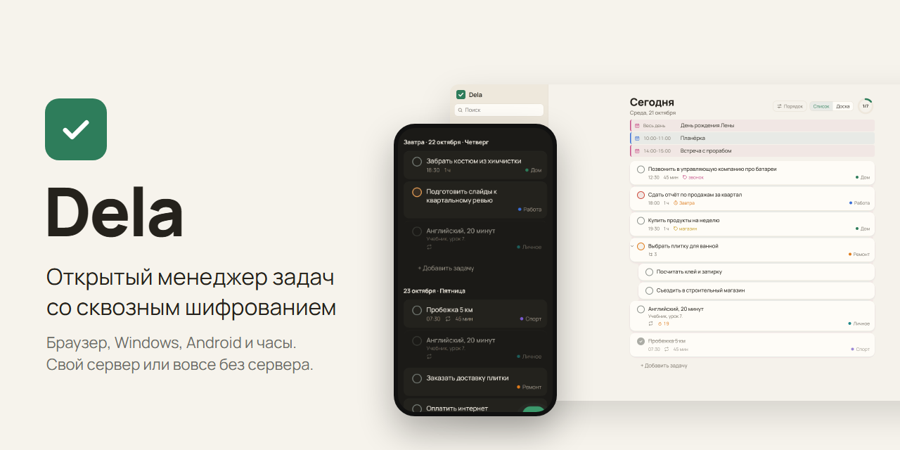
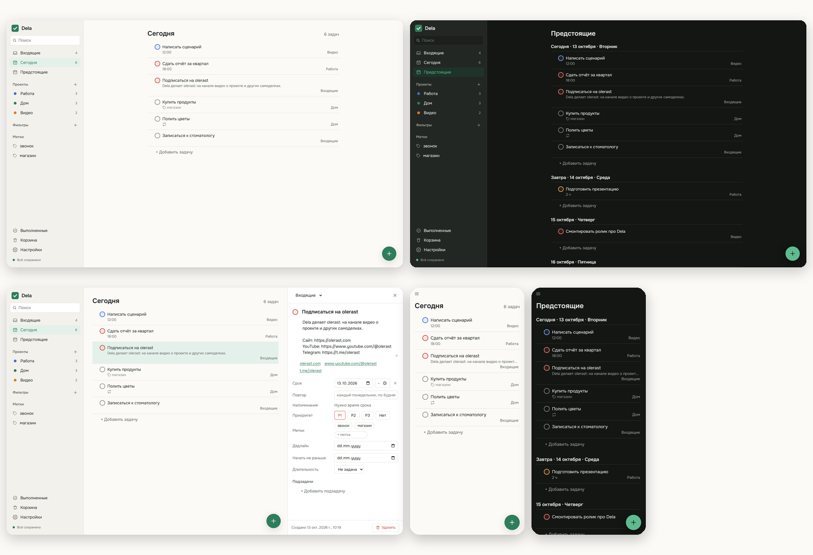
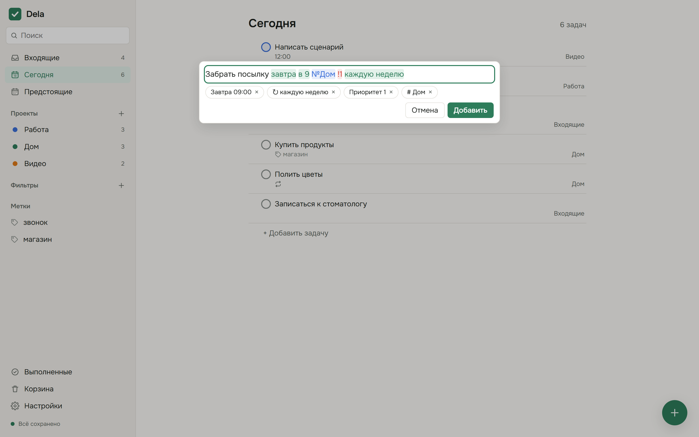

<p align="center">
  
</p>

<h1 align="center">Dela: менеджер задач со сквозным шифрованием</h1>

<p align="center">
  <a href="https://github.com/olerast67/dela/releases/latest"></a>
  <a href="https://github.com/olerast67/dela/releases"></a>
  <a href="https://github.com/olerast67/dela/actions/workflows/ci.yml"></a>
  <a href="LICENSE"></a>
  <a href="docs/architecture.md"></a>
  
</p>

<p align="center">
  <a href="https://github.com/olerast67/dela/releases/latest"></a>
  &nbsp;
  <a href="https://github.com/olerast67/dela/releases/latest"></a>
  &nbsp;
  <a href="https://apps.obtainium.imranr.dev/redirect?r=obtainium://add/https://github.com/olerast67/dela"></a>
  &nbsp;
  <a href="#установка-сервера"></a>
</p>

<p align="center"><a href="README.md">English</a> · <b>Русский</b> · <a href="https://olerast67.github.io/dela/ru.html">Сайт</a> · <a href="https://olerast67.github.io/dela/demo/">Демо без сервера</a></p>

---

**Dela** это открытый менеджер задач, который ставится на свой сервер. На каждом устройстве лежит полная копия задач, поэтому приложение открывается сразу и работает без сети. Задачи шифруются на устройстве ключом, которого у сервера нет: сервер хранит и пересылает только шифротекст.

Я делал Dela как замену Todoist на своём сервере: быстрое добавление обычной фразой, «Сегодня» и «Предстоящее», повторы, фильтры в синтаксисе Todoist и перенос задач из Todoist. Все функции бесплатные.

## Скриншоты

<p align="center">
  
</p>

Быстрое добавление распознаёт дату, время, повтор, проект и приоритет во время ввода:

<p align="center">
  
</p>

## Возможности

| Раздел | Что работает |
|---|---|
| Быстрое добавление | Русские и английские фразы: «позвонить маме завтра в 19 №Дом каждую неделю !1». Распознанное подсвечивается, одним нажатием слово остаётся текстом. В русской раскладке `№` работает как `#`, `!1` как `p1`. Напоминание той же фразой: «напомни за час и за 10 минут», «напомни в 9», «без напоминания». Вставленный список становится задачами, по одной на строку |
| Порядок | Проекты с подпроектами, разделы, подзадачи, метки, приоритеты 1-4, срок со временем и часовым поясом, дата начала, дедлайн, длительность |
| Виды | Сегодня, Предстоящее, проект списком или доской, метки, поиск, выполненные, история действий, корзина |
| Шаблоны | Проект можно сохранить шаблоном и создавать по нему новые, есть готовые шаблоны и шаблоны в файлах |
| Календарь | День, неделя и месяц. Задачу можно перетащить на другой день или в сетку часов, растянуть за нижний край, чтобы поменять длительность, а нажатие на пустой час добавляет задачу на это время |
| Повторы | По расписанию или от даты выполнения: «каждый 2-й вторник месяца», «каждые 3 дня после выполнения», «последний день месяца» |
| Фильтры | Синтаксис Todoist `(today \| overdue) & p1`, `#Работа & !@ждать`, `7 days`, `search: молоко` и русские слова: «сегодня», «просрочено» |
| Напоминания | В открытом приложении, через Web Push при закрытом браузере, на Android через будильники без сети и через UnifiedPush (ntfy) без сервисов Google |
| Общие проекты | Участники приглашаются по почте, исполнители, комментарии с файлами. Ключ проекта запечатывается открытым ключом каждого участника, файлы шифруются на устройстве |
| Клавиатура | `Ctrl+K` палитра команд, `Q` новая задача, `J`/`K`, `E` выполнить, `T` на сегодня, `Ctrl+Z` отменяет последние 100 действий. Сочетания привязаны к физическим клавишам и работают в любой раскладке |
| Приложения | Веб (PWA), Windows со значком в трее и глобальной клавишей `Ctrl+Shift+Space`, Android с пунктом «Поделиться в Dela», виджетом со списком задач и плиткой быстрого добавления в шторке |
| Языки | Английский и русский. Приложение берёт язык системы, «Настройки → Язык» меняет его. Быстрое добавление и фильтры понимают фразы на обоих языках |
| Свои данные | Перенос из Todoist по токену API или из файла экспорта, выгрузка в JSON и Markdown, удаление задач навсегда и удаление аккаунта |
| Защита | Пароль не уходит с устройства, вход по passkey с PRF, ключ восстановления, вход с одноразовым кодом (TOTP), список устройств с отзывом, блокировка приложения PIN-кодом и отпечатком на Android |

## Скачать

| Платформа | Файл | Что знать |
|---|---|---|
| Windows 10 и 11 | `Dela_<версия>_x64-setup.exe` | Ставится для текущего пользователя. У установщика пока нет подписи кода, поэтому SmartScreen попросит подтверждение. Следующие версии программа ставит сама |
| Android 7 и новее | `Dela-<версия>-android.apk` | Обновления через [Obtainium](https://apps.obtainium.imranr.dev/redirect?r=obtainium://add/https://github.com/olerast67/dela) |
| Любой браузер | адрес вашего сервера | Ставится как PWA на компьютер и Android |

Все файлы на [странице выпусков](https://github.com/olerast67/dela/releases/latest). При первом входе приложение спрашивает адрес сервера. [Демо](https://olerast67.github.io/dela/demo/) работает без сервера и хранит задачи только в браузере.

## Установка сервера

Нужен сервер с Docker и доменное имя, запись DNS которого указывает на сервер. Service worker и Web Push работают только по HTTPS, сертификат получает встроенный Caddy.

```bash
mkdir dela && cd dela
curl -fsSLO https://raw.githubusercontent.com/olerast67/dela/main/docker-compose.yml
curl -fsSL https://raw.githubusercontent.com/olerast67/dela/main/.env.example -o .env
nano .env    # свой адрес почты и домен
docker compose --profile https up -d
```

Потом откройте `https://<ваш домен>` и зарегистрируйтесь с адресом из `.env`.

Если обратный прокси уже есть, запускайте без профиля: `docker compose up -d`. Тогда Dela слушает `127.0.0.1:8080`, а сайт для Caddy выглядит так:

```
tasks.example.com {
	reverse_proxy 127.0.0.1:8080
}
```

Первый аккаунт регистрируется только с адресом из `DELA_ADMIN_EMAIL` и становится администратором. Дальше регистрация идёт по приглашениям: «Настройки → Приглашения» создаёт ссылку для одного человека.

### Настройки

| Переменная | По умолчанию | Что задаёт |
|---|---|---|
| `DELA_ADMIN_EMAIL` | пусто | Единственный адрес, с которым можно зарегистрироваться первым |
| `DELA_DOMAIN` | пусто | Домен для встроенного Caddy (`--profile https`) |
| `DELA_OPEN_REGISTRATION` | `false` | Регистрация без приглашения |
| `DELA_TRUST_PROXY` | `false` | Брать адрес клиента из `X-Forwarded-For` для лимита попыток входа. Включать только за прокси |
| `DELA_PORT` | `8080` | Порт сервера |
| `DELA_DATA_DIR` | `/data` в образе | База и резервные копии |
| `DELA_BACKUP_KEEP` | `7` | Сколько ежедневных копий базы хранить, `0` отключает |
| `DELA_SESSION_TTL_DAYS` | `180` | Срок жизни сессии устройства |
| `DELA_MAX_RECORDS_PER_SPACE` | `500000` | Предел хранимых полей в одном пространстве |
| `DELA_MAX_FILE_MB_PER_SPACE` | `1024` | Предел зашифрованных файлов в одном пространстве, МБ. Один файл до 7 МБ |
| `DELA_VAPID_SUBJECT` | адрес репозитория | Контакт для сервисов push, `mailto:` или `https:` |
| `DELA_PUBLIC_URL` | пусто | Адрес, по которому открывают веб-клиент, например `https://tasks.example.com`. Нужен для passkey |
| `DELA_MAX_SHARED_SPACES` | `200` | Сколько общих проектов может создать один пользователь |
| `DELA_PUSH_HOSTS` | пусто | Свои распространители UnifiedPush (имена хостов через запятую); ntfy.sh разрешён по умолчанию |

### Обновление и резервные копии

```bash
docker compose pull && docker compose --profile https up -d
```

Образ `latest` это последний выпуск, конкретная версия доступна по номеру, например `ghcr.io/olerast67/dela:0.8.0`. Миграции идут при запуске, перед ними сервер копирует базу в `/data/dela.sqlite.before-vN-<время>.bak`. Раз в сутки он пишет снимок в `/data/backups`. Открытая выгрузка есть в приложении: «Настройки → Экспорт».

## Безопасность

Argon2id выводит из пароля на устройстве два ключа: один подтверждает вход на сервере, второй открывает мастер-ключ аккаунта. Каждое изменение шифруется XChaCha20-Poly1305 ключом своего пространства (libsodium). Вместо пароля можно входить по passkey с расширением PRF: ключ аккаунта обёрнут секретом, который passkey выдаёт на устройстве, сервер этот секрет не видит.

Сервер видит адреса почты, устройства, участников общих проектов, время изменений, размеры с точностью до 64 байт и время напоминаний. Текст задач, даты, метки, названия проектов, имена полей и идентификаторы записей попадают на сервер только зашифрованными. Если потеряны и пароль, и ключ восстановления, данные расшифровать нельзя.

Известные ограничения: в браузере данные лежат в IndexedDB расшифрованными (ключи аккаунта обёрнуты неизвлекаемым ключом WebCrypto); участник, которого убрали из общего проекта, сохраняет то, что уже видел, а проект получает новый ключ, и новых изменений этот участник не прочитает; блокировка PIN-кодом закрывает экран приложения и не шифрует данные на устройстве ещё раз; комментарии подписаны авторами (Ed25519), а правки задач в общих проектах не подписаны, и участники доверяют друг другу в них; ключ восстановления открывает аккаунт без кода TOTP, если в «Настройки → Двухфакторный вход» не включить код и для него; виджет Android хранит показываемые задачи в закрытой папке приложения без шифрования; голосовой ввод на Android использует системное распознавание речи, и сервис распознавания (обычно Google) может отправить запись в сеть, хотя Dela просит распознавать на устройстве. Подробности в [docs/architecture.md](docs/architecture.md), как сообщить об уязвимости, в [SECURITY.md](SECURITY.md).

### Проверка веб-версии

В браузере код веб-версии отдаёт сервер. Если сервер захватят, этот код можно изменить и перехватить пароль при следующем входе. Приложения для Windows и Android несут свой код, а их обновления подписаны ключом проекта.

Для браузера есть расширение Dela Verify (папка `extension/` в репозитории). К каждому выпуску приложен `web-manifest.json` с хешами SHA-256 всех файлов веб-версии, подписанный ключом проекта `y3Zkairxm+9yU65AqArxf1PUT63ygFlnRAs676WEZGs=` (Ed25519). Расширение спрашивает у сервера его версию, скачивает подписанный список этой версии с GitHub и сверяет его с файлами, которые загрузила страница. Зелёный значок означает, что всё совпало. Красный значок и плашка на странице означают несовпадение, и вводить пароль на такой странице нельзя. Ещё расширение предупреждает, если версия сервера стала ниже.

Установка: скачайте `Dela-Verify-<версия>.zip` из выпуска и распакуйте. В Chrome или Edge откройте «Расширения», включите режим разработчика и выберите «Загрузить распакованное»; в Firefox через `about:debugging`. Потом добавьте адрес своего сервера в настройках расширения.

Проверка работает с официальным образом `ghcr.io/olerast67/dela`: у образа, собранного в другом месте, хеши файлов могут отличаться. Расширение сверяет файлы, которые загрузила страница, с тем, что сервер отдаёт ему самому, поэтому сервер, который отвечает расширению иначе, чем странице, проверку пройдёт.

## Поддержать проект

Dela бесплатная, платных функций в ней нет. Донаты идут на время для новых платформ и на внешний аудит безопасности.

- [Разовый донат на Boosty](https://boosty.to/olerast/donate): карты большинства стран, в России «Мир» и СБП.
- [Подписка на Boosty](https://boosty.to/olerast).
- Адрес для USDT в сети TRON в [DONATE.md](DONATE.md).

Звезда репозиторию тоже помогает: по ней проект находят другие люди.

## Автор

Я olerast, снимаю видео о проектах, которые делаю и проверяю на себе: [YouTube](https://www.youtube.com/@olerast), [Telegram](https://t.me/olerast), [olerast.com](https://olerast.com). Код проекта пишет Claude от Anthropic по моим задачам. Модульные и сквозные тесты гоняются в GitHub Actions на каждом коммите.

## Планы

Следующие пункты [плана](ROADMAP.md): сборка выпусков в GitHub Actions с заверенным происхождением, подпись установщика для Windows, расширение для браузера, которое сверяет веб-версию с выпуском, подписанные комментарии в общих проектах, F-Droid и установка в один клик в панелях для домашних серверов. Потом привычки и таймер помодоро, события календарей рядом с задачами, напоминание по месту, приложение для Wear OS и локальный сервер MCP для ИИ-ассистентов.

## Разработка

Нужен Node.js 22.18 или новее.

```bash
npm install
npm run check        # проверка типов и модульные тесты
npm run test:e2e     # сценарии Playwright в Chromium
npm run build:web && npm start   # сервер с веб-клиентом на http://localhost:8080
```

| Папка | Что внутри |
|---|---|
| `packages/core` | Общее ядро: синхронизация, шифрование, модель задач, разбор фраз, повторы, фильтры |
| `apps/server` | Сервер на Node.js, Hono и встроенном SQLite |
| `apps/web` | Веб-клиент на React и Vite |
| `apps/desktop` | Приложение для Windows на Tauri 2 |
| `apps/mobile` | Приложение для Android на Capacitor |

Перед pull request прочитайте [CONTRIBUTING.md](CONTRIBUTING.md).

## Лицензия

[AGPL-3.0](LICENSE).
