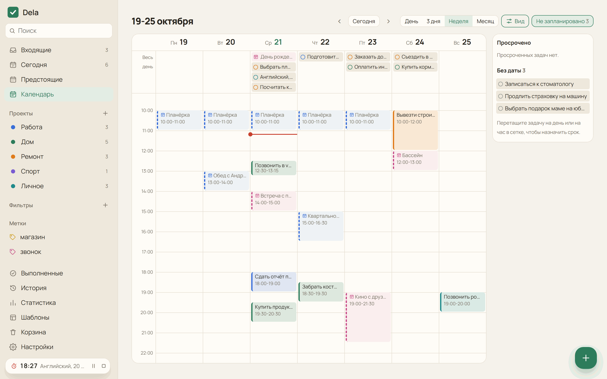
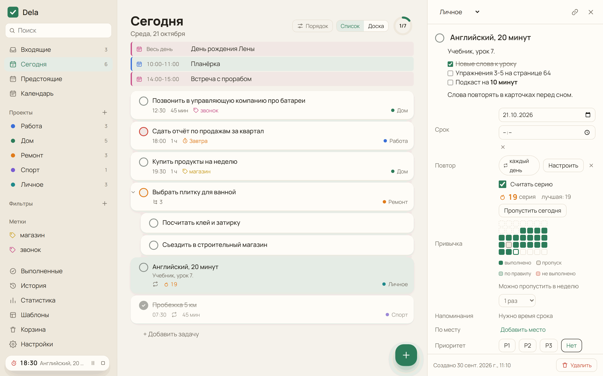
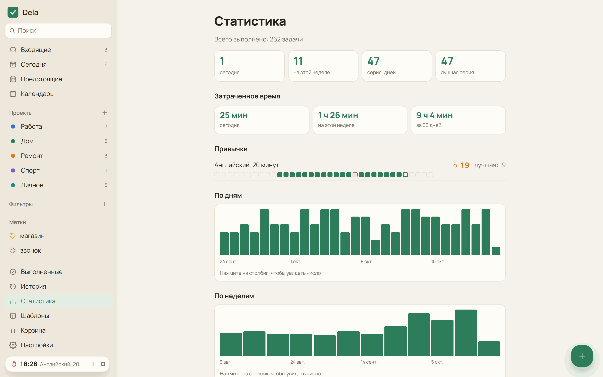
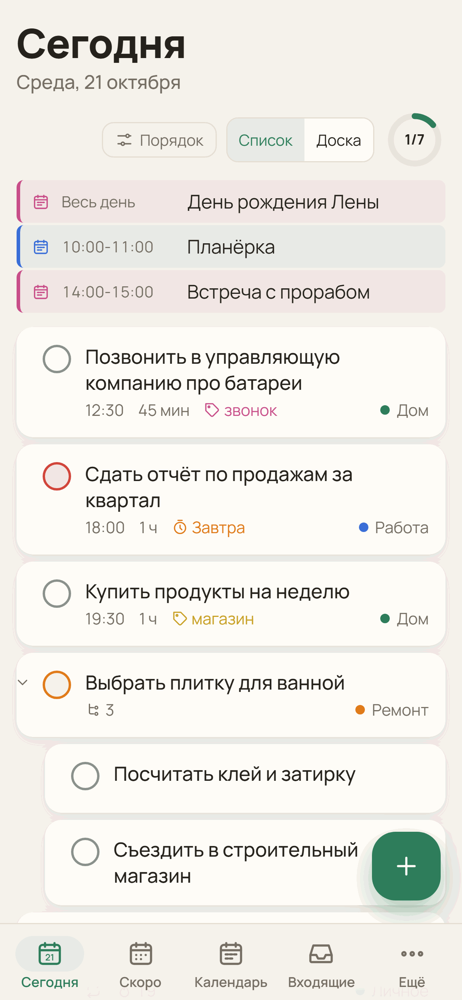
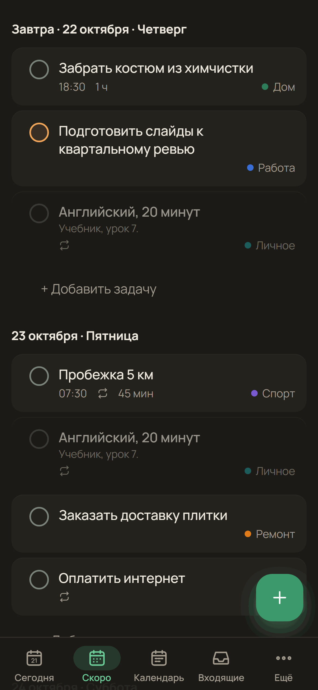

<p align="center">
  
</p>

<h1 align="center">Dela</h1>

<p align="center"><a href="README.md">English</a> · <b>Русский</b> · <a href="https://olerast67.github.io/dela/ru.html">Сайт</a> · <a href="https://olerast67.github.io/dela/demo/">Демо без сервера</a></p>

<p align="center">
  <a href="https://github.com/olerast67/dela/releases/latest"></a>
  <a href="https://github.com/olerast67/dela/releases"></a>
  <a href="https://github.com/olerast67/dela/actions/workflows/ci.yml"></a>
  <a href="LICENSE"></a>
  <a href="docs/architecture.md"></a>
  
</p>

<p align="center">
  <a href="https://github.com/olerast67/dela/releases/latest"></a>
  &nbsp;
  <a href="https://github.com/olerast67/dela/releases/latest"></a>
  &nbsp;
  <a href="https://apps.obtainium.imranr.dev/redirect?r=obtainium://add/https://github.com/olerast67/dela"></a>
  &nbsp;
  <a href="#свой-сервер"></a>
</p>

Dela это открытый менеджер задач со сквозным шифрованием для браузера, Windows, Android и часов на Wear OS. Задачи шифруются на ваших устройствах, сервер хранит и пересылает только шифротекст. Сервер вы ставите сами одной командой Docker, а попробовать Dela можно и без сервера: тогда задачи хранятся в браузере.

На каждом устройстве лежит полная копия задач, поэтому приложения открываются без ожидания сети и работают офлайн. Расширение Dela Verify сверяет веб-версию, которую отдаёт ваш сервер, с подписанным выпуском, а к файлам выпусков приложено заверенное происхождение сборки из GitHub Actions. Все функции бесплатные.

<p align="center">
  
</p>

## Содержание

- [Возможности](#возможности)
- [Установка приложений](#установка-приложений)
- [Свой сервер](#свой-сервер)
- [ИИ-ассистенты (dela-mcp)](#ии-ассистенты-dela-mcp)
- [Безопасность и приватность](#безопасность-и-приватность)
- [Сборка из исходников](#сборка-из-исходников)
- [Поддержка и лицензия](#поддержка-и-лицензия)

## Возможности

### Задачи и быстрое добавление

- Быстрое добавление разбирает русские и английские фразы во время ввода: «позвонить маме завтра в 19 №Дом каждую неделю !1», «купить краску завтра в 10 напомни за час». Распознанные части подсвечиваются, одним нажатием слово остаётся текстом.
- Вставленный список становится задачами, по одной на строку. Строка с отступом становится подзадачей, отмеченные пункты `[x]` пропускаются, а перед добавлением список можно поправить текстом.
- Проекты с подпроектами, разделы, подзадачи, метки, приоритеты 1-4, срок со временем и часовым поясом, дата начала, дедлайн и длительность. У проектов и разделов есть описания в Markdown.
- Повторы по расписанию или от даты выполнения («каждый 2-й вторник месяца», «каждые 3 дня после выполнения») задаются фразой или кнопками.
- В описаниях задач и комментариях работает Markdown: заголовки, списки, ссылки, таблицы и чек-листы. Пункт чек-листа в описании отмечается нажатием.
- Фильтры в синтаксисе Todoist (`(today | overdue) & p1`, `#Работа & !@ждать`), группировка и сортировка по дате, приоритету, проекту или метке, «Сегодня» доской по приоритетам.
- Несколько задач выделяются через Ctrl и щелчок или долгим нажатием, и их можно разом выполнить, перенести, переместить в проект или пометить. Одна «Отмена» возвращает всё действие.
- Ctrl+Shift+C копирует ссылку на текущий экран или задачу. Ссылка открывается в браузере и в приложениях для Android и Windows.

<p align="center">
  
</p>

### «Сегодня», календарь и события

- В «Сегодня» над задачами стоят события календарей на этот день, подзадачи показаны под родителем, а выполненный сегодня повтор остаётся зачёркнутой строкой до конца дня.
- Календарь показывает день, 3 дня, неделю или месяц. Задачи перетаскиваются между днями, в сетку часов и из панели «Не запланировано» с просроченными задачами и задачами без даты. На телефоне задачу нужно удержать и перетащить пальцем.
- События из ссылки iCal (например, секретного адреса календаря Google) видны в «Сегодня» и в календаре только для чтения. На Android можно показать и события из календарей телефона, они остаются на телефоне.

<p align="center">
  
</p>

### Привычки, помодоро и статистика

- Повторяющуюся задачу можно сделать привычкой. В строке видна текущая серия, а в карточке лучшая серия, последние пять недель и кнопка «Пропустить сегодня». Привычке можно разрешить до 6 пропусков в неделю, и серия от них не прервётся.
- Таймер помодоро в карточке задачи по умолчанию отсчитывает 25 минут работы и 5 минут перерыва. Отработанное время копится в задаче в поле «Затрачено».
- Статистика считает выполненные задачи по дням и неделям, серии дней, затраченное время и выполненное по проектам. Считается она на устройстве.

<p align="center">
  
  
</p>

### Напоминания и телефон

- Напоминания приходят в открытом приложении, через Web Push в браузере, из расписания будильников Android без сети и через UnifiedPush (ntfy) без сервисов Google.
- Срочная задача на Android звенит полноэкранным будильником поверх экрана блокировки, в беззвучном режиме и в режиме «Не беспокоить».
- Напоминание по месту на Android срабатывает при входе в зону или выходе из неё. Телефон следит за зонами через `LocationManager` без сервисов Google Play, а координаты попадают на сервер только внутри зашифрованной задачи.
- Картинку или голосовое сообщение можно отправить в Dela через «Поделиться» на Android: текст распознаётся на телефоне (Tesseract для текста, sherpa-onnx для речи) и открывается в быстром добавлении. Модели скачиваются по запросу.
- Утренняя сводка в выбранное время: «Сегодня: 5 задач, 2 просрочено».
- Виджет на главном экране Android показывает «Сегодня», неделю или проект, а плитка в шторке открывает быстрое добавление.

### Windows, часы и ИИ-ассистенты

- У программы для Windows есть значок в трее. Она открывает быстрое добавление по `Ctrl+Shift+Space`, может запускаться при входе в Windows, открывает проект или задачу в отдельном окне и обновляется сама из подписанных выпусков.
- Приложение для Wear OS показывает «Сегодня», отмечает задачи выполненными и присылает напоминания. Оно само входит на ваш сервер, телефон и сервисы Google ему не нужны.
- [dela-mcp](#ии-ассистенты-dela-mcp) даёт Claude Desktop и другим клиентам MCP инструменты, чтобы находить, добавлять, менять и выполнять задачи. Программа работает на вашем компьютере и держит ключи там.

### Общие проекты, файлы и ваши данные

- Общие проекты с участниками по приглашению на почту, исполнителями и комментариями. Комментарии подписаны авторами.
- К комментариям прикрепляются файлы до 100 МБ (предел сервера по умолчанию). Каждый файл шифруется на устройстве и загружается частями по 4 МиБ; прерванная загрузка продолжается с недостающих частей.
- Импорт из Todoist по токену API или файлом выгрузки, экспорт в JSON и Markdown, шаблоны проектов, история действий.
- Интерфейс на русском и английском, язык берётся из системы или выбирается в настройках.

<p align="center">
  
  
</p>

## Установка приложений

Все файлы лежат на [странице выпусков](https://github.com/olerast67/dela/releases/latest). Адрес сервера приложения спрашивают при первом входе.

| Платформа | Файл | Примечания |
|---|---|---|
| Android 7 и новее | `Dela-<версия>-android.apk` | Обновления через [Obtainium](https://apps.obtainium.imranr.dev/redirect?r=obtainium://add/https://github.com/olerast67/dela). В F-Droid и Google Play Dela пока нет |
| Windows 10 и 11 | `Dela_<версия>_x64-setup.exe` | Ставится для текущего пользователя. Установщик пока не подписан сертификатом, поэтому SmartScreen просит подтверждение. Следующие версии программа ставит сама |
| Wear OS 3 и новее | `Dela-<версия>-wear.apk` | Ставится через ADB по Wi-Fi из режима разработчика часов: `adb install Dela-<версия>-wear.apk`. На часах нужно войти с почтой и паролем |
| Любой браузер | адрес вашего сервера | Ставится как PWA на компьютер и Android. На iPhone Safari добавляет его на экран «Домой», Web Push работает начиная с iOS 16.4 |

[Демо](https://olerast67.github.io/dela/demo/) работает без сервера и хранит задачи только в вашем браузере.

Каждый APK и установщик собирает [процесс выпуска](.github/workflows/release.yml) из исходников с тегом версии. Скачанный файл проверяется так:

```bash
gh attestation verify Dela-<версия>-android.apk --repo olerast67/dela
```

## Свой сервер

Нужен сервер с Docker и домен, DNS-запись которого указывает на этот сервер. Service worker и Web Push требуют HTTPS, сертификат встроенный Caddy получает сам.

```bash
mkdir dela && cd dela
curl -fsSLO https://raw.githubusercontent.com/olerast67/dela/main/docker-compose.yml
curl -fsSL https://raw.githubusercontent.com/olerast67/dela/main/.env.example -o .env
nano .env    # ваша почта и домен
docker compose --profile https up -d
```

Потом откройте `https://<ваш домен>` и зарегистрируйтесь с почтой из `DELA_ADMIN_EMAIL`. Этот первый аккаунт становится администратором. Остальные регистрируются по ссылке-приглашению из «Настройки → Приглашения», если не включён `DELA_OPEN_REGISTRATION`.

Если обратный прокси у вас уже есть, запускайте без профиля: `docker compose up -d`. Тогда Dela слушает `127.0.0.1:8080`, и сайт для Caddy выглядит так:

```
tasks.example.com {
	reverse_proxy 127.0.0.1:8080
}
```

Образ `ghcr.io/olerast67/dela` собирается для amd64 и arm64. Тег `latest` указывает на последний выпуск, `edge` на ветку main, а конкретная версия доступна по номеру (`ghcr.io/olerast67/dela:<версия>`).

### Настройки сервера

Настройки задаются переменными окружения. С `docker-compose.yml` из репозитория их пишут в `.env`. Compose передаёт серверу `DELA_ADMIN_EMAIL`, `DELA_OPEN_REGISTRATION`, `DELA_PUBLIC_URL`, `DELA_BACKUP_KEEP`, `DELA_MAX_FILE_MB`, `DELA_MAX_FILE_MB_PER_SPACE`, `DELA_CALENDAR_HOSTS` и `DELA_PUSH_HOSTS`, остальные можно добавить в его раздел `environment`.

| Переменная | По умолчанию | Что делает |
|---|---|---|
| `DELA_ADMIN_EMAIL` | пусто | Единственный адрес, с которым можно зарегистрироваться первым. Этот аккаунт становится администратором |
| `DELA_DOMAIN` | пусто | Домен для встроенного Caddy (`--profile https`). Нужен только `docker-compose.yml` |
| `DELA_PUBLIC_URL` | пусто | Адрес, по которому открывают веб-версию, например `https://tasks.example.com`. Нужен для passkey |
| `DELA_OPEN_REGISTRATION` | `false` | `true` разрешает регистрацию без приглашения |
| `DELA_MAX_FILE_MB` | `100` | Самый большой файл в комментарии, МБ |
| `DELA_MAX_FILE_MB_PER_SPACE` | `1024` | Все зашифрованные файлы одного пространства проекта, МБ |
| `DELA_CALENDAR_HOSTS` | пусто | Хосты календарей, из которых веб-версия может загружать подписки iCal, через запятую, например `calendar.example.com`. Приложения для Android и Windows загружают любой календарь и без этой настройки |
| `DELA_PUSH_HOSTS` | пусто | Свои распространители UnifiedPush, имена хостов через запятую. ntfy.sh разрешён и так |
| `DELA_BACKUP_KEEP` | `7` | Сколько ежедневных снимков базы хранить в `<данные>/backups`. `0` выключает снимки |
| `DELA_SESSION_TTL_DAYS` | `180` | Срок жизни сессии устройства, дней |
| `DELA_MAX_RECORDS_PER_SPACE` | `500000` | Сколько полей хранится в одном пространстве проекта |
| `DELA_MAX_SHARED_SPACES` | `200` | Сколько общих проектов может создать один пользователь |
| `DELA_TRUST_PROXY` | `false` (`true` в `docker-compose.yml`) | Брать адрес клиента из `X-Forwarded-For` для ограничения попыток входа. Включайте только за обратным прокси: заголовок можно подделать |
| `DELA_VAPID_SUBJECT` | `https://github.com/olerast67/dela` | Контакт для push-сервисов, `mailto:` или `https:` |
| `DELA_PORT` | `8080` | Порт сервера. Работает и `PORT` |
| `DELA_HOST` | `0.0.0.0` | Адрес, на котором слушает сервер |
| `DELA_DATA_DIR` | `./data`, в образе `/data` | Папка базы и резервных копий |
| `DELA_DB_PATH` | `<данные>/dela.sqlite` | Файл базы |
| `DELA_WEB_DIR` | собранная веб-версия | Папка веб-версии, которую отдаёт сервер. Пустое значение оставляет только API |
| `DELA_CORS_ORIGINS` | пусто | Источники, которым разрешено обращаться к API, через запятую. Пустое значение разрешает любой источник, а приложения для Windows и Android обращаются к API со своих источников |
| `DELA_MAX_CLOCK_DRIFT_MS` | `60000` | На сколько миллисекунд метка изменения может опережать часы сервера |

### Обновление и резервные копии

```bash
docker compose pull && docker compose --profile https up -d
```

Миграции идут при запуске, перед ними сервер копирует базу в `/data/dela.sqlite.before-vN-<время>.bak`. Раз в сутки он пишет снимок в `/data/backups`. Открытая выгрузка есть в приложении в «Настройки → Экспорт».

## ИИ-ассистенты (dela-mcp)

`dela-mcp` это сервер MCP, который работает на вашем компьютере и подключает к задачам Claude Desktop и другие клиенты MCP. Он входит на ваш сервер Dela как новое устройство аккаунта, держит ключи на компьютере и расшифровывает задачи на месте. Пакет опубликован в npm под именем `dela-mcp`, ему нужен Node.js 22.18 или новее.

```sh
npx -y dela-mcp login   # адрес сервера, почта, пароль и код 2FA, если он включён
```

В Claude Desktop откройте Settings → Developer → Edit Config, добавьте сервер в `claude_desktop_config.json` и перезапустите Claude Desktop:

```json
{
  "mcpServers": {
    "dela": { "command": "npx", "args": ["-y", "dela-mcp"] }
  }
}
```

Инструменты: `search_tasks`, `list_projects`, `add_task` (фраза быстрого добавления на русском или английском), `update_task`, `complete_task` и `today`. Инструментов для удаления нет. Компьютер появляется в «Настройки → Устройства», отозвать его можно там или командой `npx dela-mcp logout`. Ассистент видит расшифрованными те задачи, которые запросил. Как хранятся сессия и ключи, описано в [packages/mcp/README.md](packages/mcp/README.md) (по-английски).

## Безопасность и приватность

Argon2id выводит из пароля на устройстве два ключа: один подтверждает вход на сервере, второй открывает мастер-ключ аккаунта. Каждое изменение шифруется XChaCha20-Poly1305 ключом своего пространства (libsodium). Входить можно и по passkey с расширением PRF, без пароля. Ключ общего проекта запечатывается для каждого участника, а после удаления участника проект получает новый ключ.

Сервер видит адреса почты, устройства, участников общих проектов, время изменений, размеры с точностью до 64 байт и время напоминаний. Текст задач, даты, метки, названия проектов, имена полей и идентификаторы записей попадают на сервер только зашифрованными. Если потеряны и пароль, и ключ восстановления, данные расшифровать нельзя. Статистика, привычки и утренняя сводка считаются на устройстве.

В браузере код веб-версии приходит с вашего сервера, и захваченный сервер может его изменить. Приложения для Windows и Android несут свой код. Для браузеров есть расширение Dela Verify (папка `extension/`, файл `Dela-Verify-<версия>.zip` в каждом выпуске). Оно сверяет файлы, которые загрузила страница, с `web-manifest.json`: там хеши SHA-256 веб-версии, подписанные ключом проекта `y3Zkairxm+9yU65AqArxf1PUT63ygFlnRAs676WEZGs=` (Ed25519). Проверка работает с официальным образом.

Известные ограничения, модель угроз и протокол описаны в [docs/architecture.md](docs/architecture.md). Что хранит сервер, перечислено в [PRIVACY.md](PRIVACY.md), как сообщить об уязвимости, написано в [SECURITY.md](SECURITY.md).

## Сборка из исходников

Нужен Node.js 22.18 или новее.

```bash
npm install
npm run check          # проверка типов и модульные тесты
npm run test:e2e       # сценарии Playwright в Chromium
npm run build:web && npm start   # сервер с веб-версией на http://localhost:8080
npm run screenshots    # снимки экрана в docs/images из веб-версии без сервера
```

| Папка | Что внутри |
|---|---|
| `packages/core` | Общее ядро: синхронизация, шифрование, модель задач, разбор фраз, повторы, фильтры |
| `packages/mcp` | dela-mcp, сервер MCP для ИИ-ассистентов |
| `apps/server` | Сервер на Node.js, Hono и встроенном SQLite |
| `apps/web` | Веб-версия на React и Vite |
| `apps/desktop` | Программа для Windows на Tauri 2 |
| `apps/mobile` | Приложение для Android на Capacitor |
| `apps/wear` | Приложение для Wear OS, ядро работает в QuickJS |
| `extension` | Dela Verify для Chrome, Edge и Firefox |

Перед pull request прочитайте [CONTRIBUTING.md](CONTRIBUTING.md). Как выпускается версия, описано в [RELEASING.md](RELEASING.md). Следующие шаги лежат в [плане](ROADMAP.md): F-Droid, шаблоны для Coolify, CasaOS, Unraid и YunoHost и подписанный установщик для Windows.

## Поддержка и лицензия

Dela бесплатная, платных функций в ней нет. Донаты идут на время для новых платформ и на внешний аудит безопасности: [разовый донат на Boosty](https://boosty.to/olerast/donate), [подписка на Boosty](https://boosty.to/olerast) или USDT в сети TRON по адресу из [DONATE.md](DONATE.md).

Я снимаю видео о проектах, которые делаю и проверяю на себе: [YouTube](https://www.youtube.com/@olerast), [Telegram](https://t.me/olerast), [olerast.com](https://olerast.com). Код проекта пишет Claude от Anthropic по моим задачам, его покрывают модульные и сквозные тесты, которые гоняются в GitHub Actions на каждом коммите.

Лицензия [AGPL-3.0](LICENSE).
